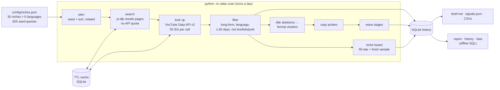

# YouTube trend radar

A daily batch pipeline that samples new YouTube uploads across 30 niches in 6 languages, keeps the history in
SQLite, and turns it into **radar signals**: which title formats are breaking out on small channels, which are
filling up with copies, and which niches look saturated next to the others.

It is a radar, not an oracle. Everything it prints is a signal for a person to check (open the videos, look at
the copies) before acting on it. Nothing it outputs is a verdict on a topic or a forecast of views.

The repo runs without an API key: it ships a small synthetic database, and a replay harness that drives the real
pipeline against a simulated YouTube.

## Quick start (no API key)

```bash
git clone https://github.com/Larious/youtube-trend-radar.git
cd youtube-trend-radar
python3 -m venv .venv && source .venv/bin/activate
pip install -e ".[dev]"

python -m radar stats                  # row counts of the bundled sample database
python -m radar report                 # the latest day, rebuilt from the database with SQL
python -m radar history was banned     # one format cluster, day by day
python -m radar bias                   # views-sorted vs fresh-sample hit rates
python -m radar demo                   # replay 5 days of the full pipeline on a synthetic YouTube
pytest                                 # 47 tests, about 2 seconds, no network
```

The read-only commands use `data/radar.sqlite` when it exists and fall back to `sample/radar_sample.sqlite`.
[`sample/example-brief.md`](sample/example-brief.md) is the brief the pipeline writes for the demo's last day.

## What it measures

| Signal | Definition |
|---|---|
| Breakout | A long-form video (6+ min), at most 30 days old, from a small (<50k subscribers) or new (created in the last 6 months) channel, that clears its language's views and views/day bar (English: 20,000 and 3,000/day) and has at least as many views as the channel has subscribers (floor 1,000). Small channels beating their size are the evidence that a newcomer can win. |
| Format cluster | Title skeletons: words common across the day's titles are kept as the format's grammar, rare words (the subject) become `X`, numbers `N`. A cluster is a skeleton 3-gram shared by breakouts from 2+ different channels: "Why Chess Was Banned in 1920" and "Why Jazz Was Banned in 1931" → `was banned in`. |
| Copy probe | For the strongest clusters (40 a day, split by language), a search of the format's grammar words: in-format uploads in the last 14 days, the median views of those 3+ days old, and in-format videos older than 60 days with 10× the views bar ("old hits"). |
| Wave stage | SATURATED: 12+ copies in 14 days with a copy median under 1/5 of the views bar, or an old format with 15+ channels and a small-channel hit rate under 15%. ESTABLISHED / CROWDED: 3+ old hits or a format older than 90 days (split at a 15% hit rate). MID: 10+ breakout channels or 10+ copies. EARLY: the rest. UNPROBED: outside the day's probe budget. |
| Pre-wave | A breakout on a new channel that matches no format yet. The radar remembers it and flags the day another channel's breakout joins it in a cluster (its "first clone"). |
| Fill rate | Uploads per day implied by YouTube's "uploaded today, newest first" page for a niche's first three seeds. |
| Fresh median | What the uploads sampled from those pages 2–7 days ago have earned since: the unbiased sample (see [the sampling-bias finding](#the-sampling-bias-finding)). |
| Saturation index | Within one language, the mean of the fill-rate rank and (100 − fresh-median rank), 0–100. High means more new supply, and less for each new upload, than the other niches. |
| Niche status | BREAKING OUT (top 20% for new-channel breakouts, index < 65), SATURATED (index ≥ 65), UNSATURATED (index ≤ 35 with demand in the top 60%), CROWDED-BUT-LIVE, COMPETITIVE, COLD (top-10 views/day under the bar), PENDING (no fresh-sample outcome yet). All relative to the other niches that day. |

The thresholds live in [`radar/signals.py`](radar/signals.py) as pure functions, each with unit tests.

## Architecture



1. **Plan.** Each niche lists seed queries per language. Every seed runs "this week, 20+ min" and "this week, 4–20 min"
   (both sorted by views) every day, and "this month, 20+ min" on a stable third of the seeds each day
   (`crc32(seed) mod 3 == day mod 3`), so the expensive sort covers every seed over three days. Each niche's first
   three seeds also run "uploaded today, newest first".
2. **Search.** Results pages come from yt-dlp's flat extractor, run in a thread pool. This costs no API quota.
   A failed search (YouTube's transient 403s) is retried once, 30 seconds later, at lower concurrency.
3. **Look up.** Video and channel IDs from every search are deduplicated and fetched with `videos.list` and
   `channels.list`, 50 IDs per call.
4. **Filter.** Long-form only (6+ minutes), not live or upcoming, not made for kids, not junk (gameplay, reactions,
   music, news re-uploads and similar), in the language the seed was searched in, at most 60 days old. A video
   belongs to the niche whose searches returned it most often.
5. **Load.** Videos and channels are upserted (dimensions) and every kept video gets today's view snapshot (fact).
   Breakouts from the last 21 days are re-measured even when search stops returning them.
6. **Cluster, probe, stage.** Format clusters per language; copy probes for the strongest; a stage for each →
   `cluster_days`.
7. **Niche board.** Today's "uploaded today" pages are stored as the fresh sample, the sample from 2–7 days ago is
   re-measured, and the niches are ranked within each language → `niche_days`.
8. **Publish.** `brief.md` (the human read), `signals.json`, `breakouts.csv`, `clusters.csv`, `niches.csv`,
   `search_errors.json`, and a copy of the brief as `LATEST.md`.

In production (5 daily runs, 7–11 Nov 2026) each run made about 1,800 searches, kept about 13,000 long-form videos,
flagged about 3,000 breakouts and 900 format clusters, and used 600–1,000 API units of the 10,000-unit daily quota.

## Data model

```
channels (cid) ─┬─< videos (id) ─┬─< snaps (id, day)            fact: views per video per day
                                 ├─< fresh (niche, lang, id)    'uploaded today' sample membership
                                 └─< lonely (id)                pre-wave breakouts and their first clone
clusters (key) ──< cluster_days (key, day)                      daily wave metrics; ids = JSON list of video ids
niche_days (niche, lang, day)                                   daily niche metrics and status
```

| Table | Grain | Key | Holds |
|---|---|---|---|
| `videos` | one row per video ever kept | `id` | title, channel `cid`, language, niche, `published`, duration, `first_seen`, `breakout_first` (first day it qualified) |
| `channels` | one row per channel | `cid` | title, `created`; `subs` and `videos` refreshed on every sighting; `first_seen`, `last_seen` |
| `snaps` | one row per video per day | `(id, day)` | `views`. Velocity is the difference between two snapshots divided by the days between them. |
| `clusters` | one row per format | `key` = `lang\|shingle` | `first_seen`, `last_seen`, `first_video` (publish date of the format's oldest video) |
| `cluster_days` | one row per format per day | `(key, day)` | `stage`, breakout `channels` and `new_channels`, `videos`, `supply_channels`, `med_vpd`, `hit_rate`, `copies14`, `copy_med`, `ids` |
| `niche_days` | one row per niche × language per day | `(niche, lang, day)` | `status`, demand (`top10_vpd`, `med_vpd`), small-channel counts and hit rate, `breakout_channels`, `new_breakout_channels`, `fill_per_day`, `newest_med`, `sat_index` |
| `fresh` | one row per sampled upload | `(niche, lang, id)` | the `day` it was sampled from an "uploaded today" page |
| `lonely` | one row per pre-wave breakout | `id` | `skeleton`, `first_seen`, `joined` (the day it got its first clone) |

The keys turn the scan's hot lookups into primary-key prefix scans: "this video's latest snapshot before today" is
`snaps(id, day)`, "this cluster a week ago" is `cluster_days(key, day)`. Daily facts are written with
`INSERT OR REPLACE` on their `(…, day)` keys and dimensions with insert-or-ignore or upserts, so re-running a day
replaces that day's facts and keeps first-seen dates.

The offline commands are plain SQL over these tables ([`radar/report.py`](radar/report.py)): `LAG()` over
`niche_days` for yesterday's status, `LAG()` over `snaps` for current views/day, `json_each()` to unnest a cluster's
breakout IDs, and `ROW_NUMBER()` to pick one snapshot per video.

The production database (not included) held, on 11 Nov 2026:

| videos | channels | snaps | clusters | cluster_days | niche_days | fresh | lonely |
|---|---|---|---|---|---|---|---|
| 35,165 | 23,914 | 94,399 | 2,437 | 4,686 | 737 | 17,579 | 1,413 |

## Quota counter and TTL cache

All of this is in [`radar/youtube.py`](radar/youtube.py).

- **Search costs no quota.** Results pages come from yt-dlp; the Data API is used only for statistics.
- **Batching.** IDs are deduplicated across all searches and looked up 50 per call. A call costs 1 unit whatever
  parts it asks for, so one call fetches snippet, statistics, contentDetails, status and liveStreamingDetails together.
- **One TTL cache for everything.** `TTLCache` is a single SQLite key–value table: key, write time, JSON value. Keys
  are namespaced: `s|query|sort|depth` for search pages, `v|id` for video stats, `c|id` for channel stats. The reader
  sets the maximum age: searches 12 h, video stats 6 h, channel stats 24 h. A second run on the same day costs
  almost nothing, and the next morning's run still gets fresh view counts, which the snapshot table depends on.
- **Negative caching.** IDs the API doesn't return (deleted or private videos) are cached as empty, so they don't
  cost a unit on every run.
- **Per-endpoint counter.** `YouTubeAPI.units` is a `Counter` keyed by endpoint, incremented under a lock before
  every attempt (retries included, so the figure is an upper bound). The brief prints it, e.g.
  `API units 15 (channels 2, videos 13)`.
- **Failures.** HTTP 429/5xx and network errors back off and retry up to four times. A 403 with `quotaExceeded`
  raises `QuotaExceeded` at once and the CLI stops the run with a message, instead of spending retries.
- **Threads.** Searches run in a thread pool; the cache serialises access with a lock over one shared connection.
- **Injectable edges.** The search fetcher, the API transport and the cache clock are parameters. The tests and the
  offline replay use that to run the same batching, caching and counting code without the network.

## The sampling-bias finding

The radar's first version measured the small-channel hit rate (the share of small or new channels' videos that are
breakouts) on the videos returned by views-sorted searches. It came out high in nearly every niche. That number was
an artefact: a results page sorted by views has room for 20 videos, so a small channel only appears there once it
has already won. The sample measured the winners, not the odds of winning.

The fix:

- In testing, only YouTube's "uploaded today, newest first" filter (`sp=CAISBAgCEAE%253D`) returned a sample that
  isn't ranked by success; the "this week" and "this month" newest-first filters still leaned towards popular videos.
- Every day the radar stores those uploads in `fresh`, then re-measures them 2–7 days later. What they earned (the
  fresh median) drives the saturation index. The views-sorted searches stay, for what they are good at: finding the
  winners and their formats.

Measured on the production database: small-channel videos (<50k subscribers), each measured once at 2–7 days old
(ages in whole days), against the radar's own breakout bar.

| Sample | Videos | Clear the breakout bar | Median views |
|---|---|---|---|
| Views-sorted searches | 8,239 | 65% | 37,662 |
| "Uploaded today" sample | 3,068 | 22% | 3,555 |

Per niche × language group (20+ videos), the views-sorted median hit rate was 66%, with 58% of groups at 60% or
more; the fresh sample's median was 17%, with 2% of groups at 60% or more. The views-sorted sample overstated the
odds about three times over and the typical outcome about ten times over.

`python -m radar bias` computes this table for any radar database. On the bundled synthetic sample it shows the
same direction (28% vs 4%) with made-up numbers. Two caveats: the fresh sample is what "uploaded today" pages show
for the seed queries, so it is unbiased by views but is not a census of every upload; and the production figures
cover five days.

## Running it live

You need Python 3.10+, yt-dlp (installed with the package) and a YouTube Data API v3 key (free; the default quota
is 10,000 units a day).

```bash
cp .env.example .env                    # put your key in .env, or: export YOUTUBE_API_KEY=...
python -m radar scan --only-langs en    # a smaller first run
python -m radar scan                    # everything: about 1,800 searches, 10-25 minutes
python -m radar report                  # read the day back from data/radar.sqlite
```

| Option | Default | Meaning |
|---|---|---|
| `--config` | `config/niches.json` | niches, seed queries per language, breakout bars |
| `--db`, `--out`, `--cache` | `data/radar.sqlite`, `data/runs`, `data/cache.sqlite` | history, daily outputs, cache |
| `--sorts` | `week_long:1,week_mid:1,month_long:3` | `sort:k` runs that sort on 1/k of the seeds each day |
| `--only-langs` | all | e.g. `en,es` |
| `--probes` | 40 | copy probes per day, shared across languages |
| `--extra` | | a JSON list of video IDs (or `{id, niche, lang}` objects) to merge in, e.g. from a trending feed |
| `--no-cache` | | ignore cached searches and stats (still writes them) |

Each run writes `data/runs/<date>/` (brief, JSON, CSVs) and updates `data/runs/LATEST.md`. The radar runs once a day
from a scheduler; a cron line works too:

```
30 6 * * * cd /path/to/youtube-trend-radar && .venv/bin/python -m radar scan >> data/scan.log 2>&1
```

## Tests and the offline replay

| File | Covers |
|---|---|
| [`tests/test_text.py`](tests/test_text.py) | tokenising (case, apostrophes, accents, Hindi vowel signs), skeletons, grammar words, shingles, language check, junk filter |
| [`tests/test_signals.py`](tests/test_signals.py) | the breakout rule, wave-stage labels, niche-status labels, ranks, fill rate, clustering |
| [`tests/test_youtube.py`](tests/test_youtube.py) | TTL expiry, 50-ID batching, the per-endpoint counter, negative caching, quota exhaustion, search retry |
| [`tests/test_pipeline.py`](tests/test_pipeline.py) | the whole scan replayed for five days, offline, and checked against the storylines planted in the synthetic world |

[`radar/offline.py`](radar/offline.py) replaces only the two network edges (yt-dlp results pages and the API's
JSON) with a seeded synthetic world of about 3,000 uploads across five niche × language pairs. It has planted
storylines: an EARLY wave that fills up to MID, an ESTABLISHED format with old hits, a SATURATED listicle, a pre-wave
breakout that gets its first clone on the last day, and a Spanish wave. The scan, cache, batching, quota counter,
filters, clustering, SQLite writes and brief all run as in production.

The bundled `sample/radar_sample.sqlite` is that replay's output: about 3,500 rows (videos 788, channels 101,
snapshots 2,056, fresh sample 468) in 390 KB. Every title, channel and number in it is made up; the repo contains
no YouTube data. `make sample` rebuilds it, with the same rows every time.

## Limits

- Search pages are samples (20 results per query), so counts are proxies. That's why statuses are ranks within a
  language, and why a signal needs a closer look before it becomes a decision.
- The week-on-week growth column needs 8 days of history.
- A cluster's name can change between days, because grammar words are recomputed from each day's titles.
- YouTube rate-limits yt-dlp with transient 403s; a few failed searches a day are normal (`search_errors.json`).
- News re-uploads, sports and kids' content can still slip past the junk filter and cluster. Read the examples
  before trusting a wave.

## Layout

```
radar/
  cli.py        command line (python -m radar ...)
  scan.py       the daily pipeline: plan, search, look up, filter, load, cluster, probe, stage, niche board, publish
  youtube.py    yt-dlp search, YouTube Data API client, TTL cache, quota counter
  store.py      SQLite schema, reads and writes
  signals.py    the rules as pure functions: breakouts, clusters, stages, niche status, ranks
  text.py       normalisation, language checks, tokens, title skeletons
  brief.py      the daily brief, signals.json and CSVs
  report.py     offline SQL: report, history, stats, sampling bias
  offline.py    the synthetic YouTube behind the demo and tests
  clock.py      one clock per run, live or simulated
config/niches.json   30 niches (29 topics plus a cross-topic "formats" group), 6 languages, 605 seed queries
sample/              the synthetic database and the brief from its last day
tests/
```

## How it was built

I built this to research which YouTube formats a new channel can still win in, and run it every morning. Most of
the code was written with Claude Code as a pair programmer. This repository is a cleaned-up, tested version of the
scripts that built the production database.
